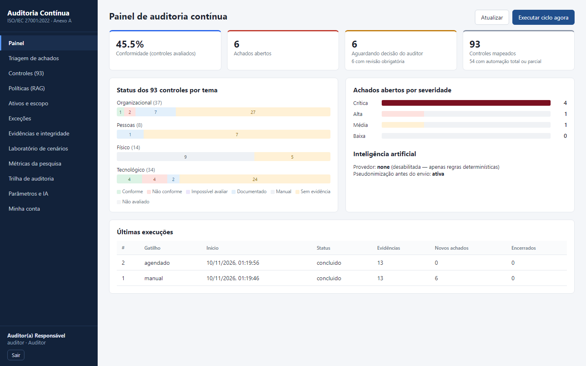
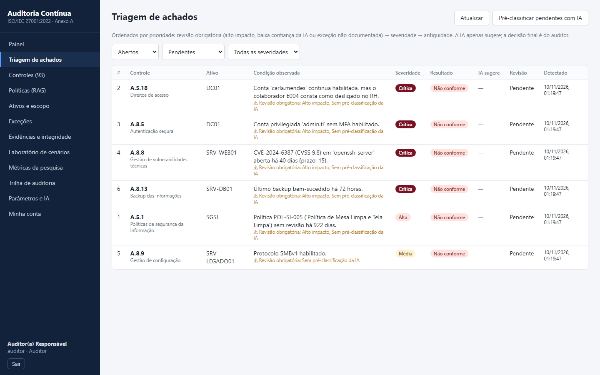
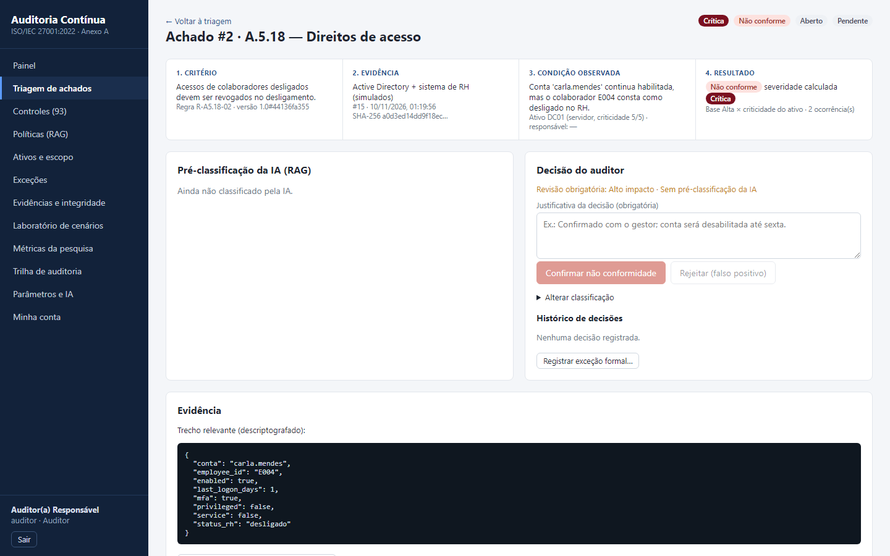
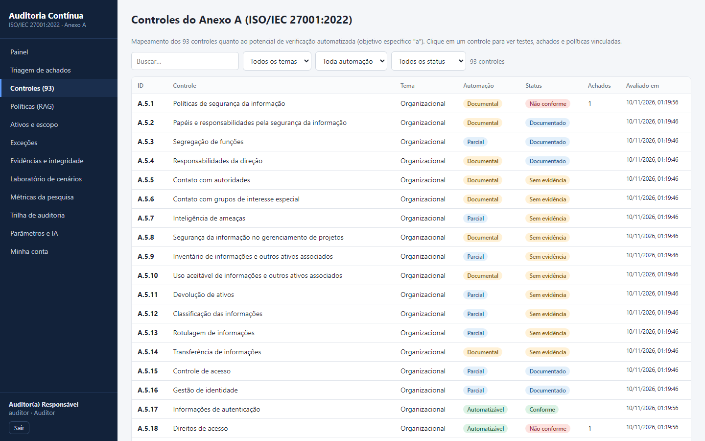
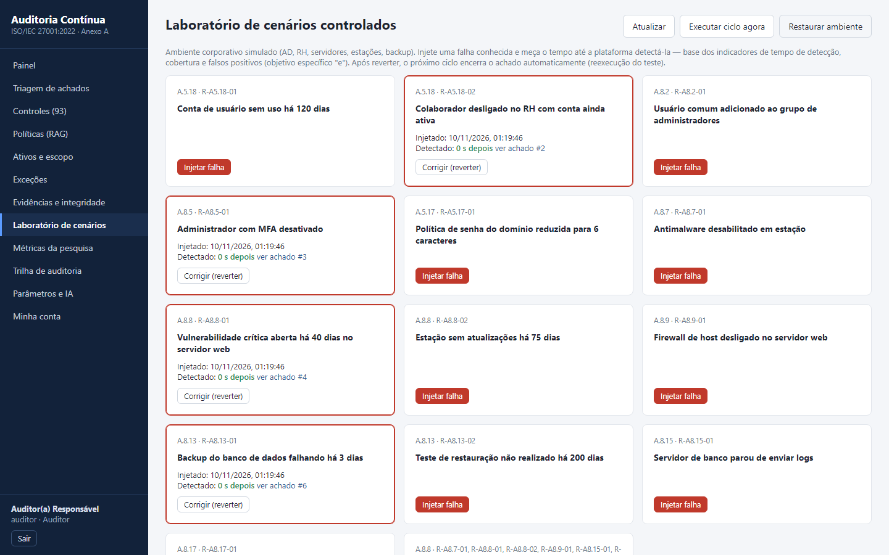
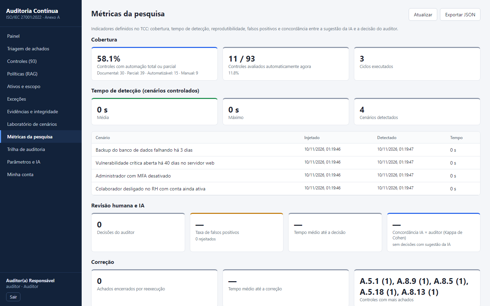
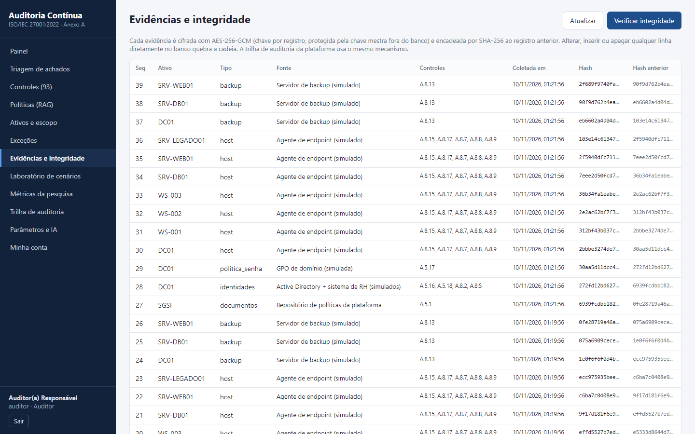

# Auditoria Contínua — ISO/IEC 27001:2022

Protótipo da plataforma proposta no TCC *"Auditoria contínua de segurança da informação por meio da automação
da verificação de controles de segurança: aplicação de inteligência artificial na análise e classificação das
não conformidades identificadas"* (Fatec São Caetano do Sul).

Toda a stack é **gratuita/open source**: Python (FastAPI), PostgreSQL + pgvector, React, Nginx, Docker.
A IA pode ser o **Gemini (plano gratuito)** ou um modelo **100% local via Ollama**.

> **Aviso:** projeto acadêmico/protótipo para ambiente de laboratório. Todos os dados, empresas e políticas
> de exemplo são fictícios. Não use em produção sem revisão de segurança.

## Telas

**Painel** — status dos 93 controles do Anexo A por tema e achados abertos por severidade


**Triagem de achados** — fila priorizada por revisão obrigatória e severidade (impacto × criticidade do ativo)


**Detalhe do achado** — rastreabilidade *critério → evidência → condição → resultado → decisão humana*


<details>
<summary>Mais telas: controles, laboratório, métricas e integridade</summary>

**Controles (93)** — classificação do potencial de automação


**Laboratório de cenários** — injeção de falhas e tempo de detecção


**Métricas da pesquisa** — cobertura, tempo de detecção, falsos positivos e Kappa IA × auditor


**Evidências e integridade** — evidências cifradas e cadeia de hash SHA-256


</details>

---

## 1. Como rodar

Pré-requisito: **Docker Desktop** (gratuito para uso pessoal, educacional e pequenas empresas)
— https://www.docker.com/products/docker-desktop/ . Alternativa 100% livre: Podman Desktop.

```powershell
git clone https://github.com/Igor-Perencine/auditoria-continua.git
cd auditoria-continua
powershell -ExecutionPolicy Bypass -File .\setup.ps1   # gera o .env com segredos aleatórios e mostra as senhas
docker compose up -d --build                            # 1ª vez demora alguns minutos
```

Acesse **https://localhost:8443** (o certificado é autoassinado: clique em "Avançado → continuar").

| Usuário | Perfil | Senha |
|---|---|---|
| `admin` | Administrador | `ADMIN_PASSWORD` no `.env` |
| `auditor`, `gestor`, `leitura` | demonstração | `DEMO_PASSWORD` no `.env` |

No primeiro login de cada usuário a plataforma **obriga o cadastro do MFA** (QR code para Google Authenticator,
Microsoft Authenticator, Aegis etc.).

Comandos úteis:

```powershell
docker compose logs -f backend      # ver logs
docker compose down                 # parar (os dados ficam no volume)
docker compose down -v              # parar e APAGAR o banco
```

Documentação interativa da API: https://localhost:8443/api/docs

### Ligando a IA

**Gemini (gratuito):** crie uma chave em https://aistudio.google.com/apikey, edite o `.env`:

```
AI_PROVIDER=gemini
GEMINI_API_KEY=sua-chave
```

e rode `docker compose up -d backend`. Em **Políticas → Gerar embeddings pendentes** (admin) indexe as políticas.

**Ollama (local, nada sai da máquina):** precisa de ~8 GB de RAM livres.

```powershell
# no .env: AI_PROVIDER=ollama
docker compose --profile ollama up -d
docker compose exec ollama ollama pull llama3.1:8b
docker compose exec ollama ollama pull nomic-embed-text
docker compose up -d backend
```

---

## 2. Roteiro de demonstração (para a banca)

1. Entre como **auditor**. No **Painel**, veja o status dos 93 controles por tema (o 1º ciclo roda ~20 s após subir).
2. **Triagem de achados**: já existem dois achados "de nascença" do laboratório:
   - **SMBv1 no SRV-LEGADO01** — a política POL-SI-003 documenta a exceção EXC-2026-003. Com IA ligada, ela
     sugere *falso positivo* **citando o trecho da política**. O auditor confere e rejeita, e depois registra a
     exceção formal em **Exceções**. Outro auditor aprova (segregação de funções), e o achado some no próximo ciclo.
   - **POL-SI-005 sem revisão há mais de 1 ano** (controle A.5.1).
3. **Laboratório**: injete "Colaborador desligado com conta ativa", clique em **Executar ciclo agora** e veja o
   **tempo de detecção**. Abra o achado: cadeia *critério → evidência → condição → resultado → decisão*.
4. Corrija (reverter) e rode o ciclo: o achado é **encerrado automaticamente** pela reexecução do teste.
5. **Evidências e integridade → Verificar integridade**: cadeias de hash íntegras. (Para provar a detecção,
   altere uma linha direto no banco e verifique de novo — veja a seção 5.)
6. **Métricas da pesquisa**: cobertura, tempo de detecção, falsos positivos, Kappa IA × auditor e reprodutibilidade.

---

## 3. Arquitetura (as 5 camadas da seção 2.5 do TCC)

```
 Coletores ──► Normalização ──► Evidência cifrada + hash ──► Regras determinísticas ──► Achados
 (simulador,     (formato por       (AES-256-GCM, cadeia        (estado observado ×          │
  AD, Wazuh)      'kind')            SHA-256)                     estado esperado)            ▼
                                                                                  Triagem por IA (RAG)
 Políticas (PDF/DOCX/MD) ──► trechos + controles ──► embeddings (pgvector) ──►   pseudonimizada, citações
                                                                                  verificáveis
                                                                                          │
                                                                    Painel do auditor ◄───┘
                                                         (decisão humana final + trilha de auditoria)
```

| Camada | Onde está |
|---|---|
| Catálogo de critérios (93 controles + parâmetros) | `backend/app/data/controls.py`, `services/params.py` |
| Integração de fontes | `backend/app/collectors/` (simulador, Active Directory, Wazuh) |
| Normalização + evidência | `collectors/base.py`, `services/evidence.py` |
| Testes (regras) | `services/rules.py` — 15 regras em 10 controles |
| Correlação via IA (RAG) | `ai/rag.py`, `ai/provider.py`, `services/pseudonymize.py` |
| Painel do auditor | `frontend/src/pages/` |
| Ciclo contínuo | `services/pipeline.py`, `services/scheduler.py` (a cada `COLLECT_INTERVAL_MINUTES`) |

### Mapeamento com os objetivos específicos

| Objetivo | Implementação |
|---|---|
| a) mapear os 93 controles e o potencial de automação | Tela **Controles**: classificação automatizável / parcial / documental / manual |
| b) critérios, fontes e rastreabilidade | Parâmetros versionados, regra + versão do critério em cada achado, cadeia de hash |
| c) coleta, normalização e verificação | Coletores → `Observation` → regras → achados, a cada ciclo |
| d) registrar, classificar e priorizar | Severidade = impacto × criticidade do ativo; fila de triagem com revisão obrigatória |
| e) avaliar em cenários controlados | **Laboratório** (14 cenários) + **Métricas** (detecção, cobertura, FP, reprodutibilidade) |
| f) IA como apoio, decisão humana | RAG com citações; aprovar/rejeitar/alterar pelo auditor; Kappa IA × auditor |

---

## 4. Segurança implementada

- **Autenticação:** Argon2id, MFA TOTP obrigatório com anti-replay, bloqueio após 5 falhas (15 min), resposta
  de tempo constante para usuário inexistente, JWT de 30 min com revogação (logout encerra todas as sessões).
- **RBAC + segregação de funções:** admin não decide achados; o auditor não decide sobre ativo do qual é
  responsável; quem solicita uma exceção não pode aprová-la; o gestor só vê os próprios ativos.
- **Criptografia em repouso:** evidências com *envelope encryption* (chave AES-256-GCM por registro, protegida
  pela `MASTER_KEY`, que fica fora do banco); segredos de MFA e trechos de achados também cifrados; o AAD
  amarra o texto cifrado ao registro.
- **Integridade:** evidências e trilha de auditoria encadeadas por SHA-256 (inspirado no ContAudIT, Fraga et
  al., 2025), com verificação sob demanda.
- **Em trânsito:** TLS 1.2/1.3 no Nginx, HSTS, CSP restritiva, X-Frame-Options, banco sem porta exposta.
- **IA:** pseudonimização, fontes restritas às políticas internas, trechos tratados como dados (mitigação de
  *prompt injection*), validação das citações (antialucinação), hash do prompt enviado registrado.

## 5. Provando a detecção de adulteração

```powershell
docker compose exec db psql -U auditoria -d auditoria -c "UPDATE audit_log SET target='adulterado' WHERE seq=3;"
```

Depois clique em **Verificar integridade**: a trilha aparece como **VIOLADA** no registro #3.
Restaure apagando o volume (`docker compose down -v`) se quiser recomeçar.

## 6. Coletores reais (experimentais)

No `.env`, `ENABLED_COLLECTORS=simulador,active_directory,wazuh` e preencha `AD_*` / `WAZUH_*`.
- **Active Directory** (LDAP/LDAPS, conta somente leitura): contas inativas, privilegiadas e política de senha.
- **Wazuh** (SIEM open source): agentes silenciosos (A.8.15) e pontuação de hardening CIS/SCA (A.8.9).

Um laboratório gratuito: VM Windows Server (avaliação de 180 dias) com AD + Wazuh em uma VM Ubuntu.

## 7. Limitações conhecidas / próximos passos

- Esquema do banco criado com `create_all` (sem migrações). Para evoluir: Alembic.
- Sem refresh token (a sessão expira em 30 min). A chave mestra fica no `.env`; em produção use um cofre (Vault/KMS).
- Rotação da `MASTER_KEY` ainda não implementada (o campo `key_version` já está preparado).
- O simulador usa idades relativas fixas (determinismo para reprodutibilidade).
- Para virar produto: multi-inquilino, SSO (OIDC), filas (Celery/Redis), relatórios PDF, testes automatizados.
